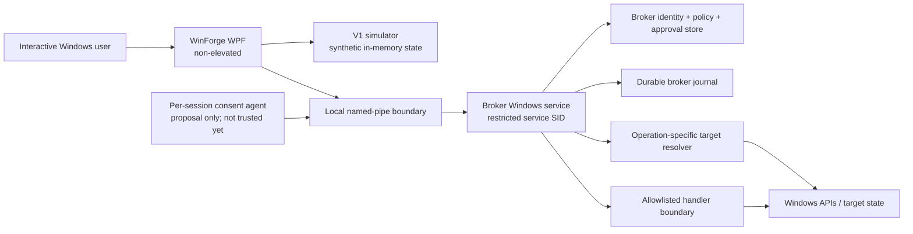

# WinForge Action Broker V2 — Separate Broker Architecture

**Status:** Design proposal plus implemented hostless contracts/model tests; no V2 host, IPC endpoint, identity provider, or real executor exists.  
**Recommendation:** The hostless typed contracts and deterministic lifecycle model are implemented. No V2 runtime host is selected; revisit per-user or machine-wide hosting only after a concrete operation establishes its privilege and coordination requirements.  
**Scope:** Future architecture for carefully reviewed operations. This is not authorization to implement or enable any operation.

## 1. Executive decision

Keep the existing V1 Action Broker in the WPF process and preserve its simulation-only behavior. V2 is a separate, additive architecture:

1. The WPF app remains non-elevated and continues to own the V1 synthetic simulation workflow.
2. No current V2 operation is selected that requires machine-wide hosting. The implemented model/test phase has no runtime host or Windows endpoint.
3. If an operation is later selected, compare the least-privileged per-user architecture first. Consider a machine-wide service only when an operation-to-rights matrix proves a machine-wide authority or coordination need that cannot be met more safely otherwise.
4. No consent mechanism currently proves that a human saw and intentionally approved the exact operation against same-user malware. Challenges and signatures bind data/state, not human intent. Consequential operations remain prohibited until an independently reviewed consent boundary is accepted.
5. Any future broker owns its allowlist, canonical request, policy, approval state, deduplication, target revalidation, journal, and recovery decisions. The client is untrusted, but broker authorization does not by itself prove human intent.
6. Every non-idempotent external effect has an explicit uncertain-outcome path. Missing completion evidence is never proof that no effect occurred.

The demand-start service and named pipe remain a candidate architecture recorded as Proposed in ADR 0012, not the selected V2 host. ADR 0011 currently requires a separate service for privileged operations; any different executable architecture must first be authorized by a new ADR that narrows or supersedes that accepted constraint. Do not impersonate across asynchronous work or use a client token as blanket authorization. See [the architecture remediation](./ACTION_BROKER_V2_ARCHITECTURE_REMEDIATION.md).

### Implemented hostless milestone boundary

`src/WinForge.ActionBroker.V2` is a pure `net10.0` model library with no project or package references. It implements request and unverified identity value models, canonical binding, authorization/lifecycle rules, recovery-step state rules, verification/rollback constraints, and typed audit validation. Deterministic fault injection and in-memory commit fakes are test-only. This milestone does not add transport DTOs, service/client layering, IPC, Windows identity acquisition, durable storage, or any executable operation. Hostless tests validate declared model behavior only, not the future host's enforcement or OS security properties.

## 2. Current V1 facts and compatibility

V1 currently registers `TrustedActionCatalog`, `ActionBrokerPolicyEngine`, `SimulatedSystemState`, `JsonFileActionBrokerJournalStore`, `ActionBrokerService`, and `ActionBrokerViewModel` as application singletons in `App.xaml.cs`. `ActionBrokerService` validates requests, creates exact request-bound approvals, serializes its lifecycle, and invokes an internal `ActionBrokerSimulationCoordinator` against synthetic in-memory state. The journal and snapshot are local JSON. The service marks unclosed starts interrupted when the journal is read. V1 has no service, pipe, OS-authenticated caller, cross-process authorization database, real target resolver, or Windows-changing executor.

V1 remains available and simulation-only throughout V2 design and any later migration. V2 must not repurpose the V1 journal as an authorization database or silently redirect V1 buttons to a service. A future UI may show “Simulation (V1)” and “Broker (V2)” as distinct modes, with no automatic fallback between them. Failure to connect to V2 must never cause a request to execute through V1 or vice versa.

The existing audit records known V1 constraints: `current-user` is a label, the JSON journal is not tamper-proof, and forced termination can leave an incomplete simulation whose in-memory effects cannot be proven. The service architecture addresses different trust boundaries but does not, by itself, resolve those facts.

## 3. Alternatives considered

| Alternative | Security properties | Operational costs / limitations | Decision |
|---|---|---|---|
| **A. Machine-wide Windows service + local named pipe** | One broker-owned policy and durable ledger; can coordinate machine-wide conflicts; separates client from service-held authority. | Installer/SCM and servicing complexity; shared cross-user state; service compromise inherits service rights; Session 0 consent and multi-session isolation are difficult. Demand-start reduces idle exposure, not risk while running. | **Deferred.** No current operation establishes that a service is necessary. Reconsider only with an operation-to-rights matrix and independent review. |
| **B. Per-request elevated helper launched by the desktop app (UAC/runas)** | No always-on service; OS consent is visible; helper lifetime can be short. | UI/client controls launch and often the request; UAC consent alone does not bind displayed details to the exact preview; process startup is a race surface; durable global deduplication/recovery is harder; an elevated helper inherits a broad token unless each action is isolated. | Not selected for general broker duty. Could be considered for a narrowly defined one-shot operation only after a separate review proves request binding and recovery. |
| **C. Per-user, non-elevated broker process in each interactive session** | Session-scoped data and token; no SCM/service installation; smaller privilege impact; user-scoped work naturally runs with the user's rights. | Cannot perform machine operations; same-user malware can interact with it; shared-resource coordination needs design; not an elevation boundary. | **Candidate only** if a concrete non-privileged user-scope use case is approved. No executable use case is selected. |

### IPC alternatives

- **Named pipes:** candidate only if a service host is later approved. A pipe name is not authentication; exact DACL, connection identity, endpoint ownership, session scope, and supported builds must be reviewed and tested first.
- **Local RPC:** offers a mature Windows authentication model and interface semantics but adds RPC interface, endpoint, security-QoS, and deployment complexity. Reconsider if named-pipe impersonation and endpoint hardening cannot meet a reviewed threat model.
- **COM/RPC local server:** supports activation and access control but adds COM registration/activation and proxy/stub deployment concerns; not selected for this narrowly scoped protocol.
- **TCP/HTTP, loopback sockets, or remote named pipes:** rejected for the initial local-only design because they add unnecessary network exposure and broader endpoint policy.

Windows reference points for a future implementation: Microsoft documents service account tokens and service-object access control in [Service User Accounts](https://learn.microsoft.com/en-us/windows/win32/services/service-user-accounts) and [Service Security and Access Rights](https://learn.microsoft.com/en-us/windows/win32/services/service-security-and-access-rights). Named-pipe endpoints support explicit security descriptors; the documented default descriptor grants read access to Everyone and anonymous users, so a future implementation must not rely on a null/default descriptor. See [Named Pipe Security and Access Rights](https://learn.microsoft.com/en-us/windows/win32/ipc/named-pipe-security-and-access-rights). These references inform the proposal; they do not prove a specific service configuration or ACL is safe.

## 4. Processes and trust boundaries

The following service diagram describes the deferred candidate only, not the selected V2 host. Current V2 work has no runtime endpoint or executable catalog.

Trust boundaries:

1. **User ↔ UI:** user input is untrusted; UI validation is usability, not security.
2. **UI ↔ service pipe:** hostile boundary. Authenticate the OS token and protocol; treat every message and claimed approval as attacker-controlled.
3. **Consent agent ↔ user/service:** distinct from caller authentication. Approval UX must show the exact broker-issued proposal. Its ability to resist same-user malware is unresolved; until proven, the service must not treat a client boolean or `current-user` string as consent proof.
4. **Service ↔ durable storage:** protect service files and keys with ACLs; treat disk-full, corruption, rollback, and write failures as security-relevant errors.
5. **Service ↔ handlers/Windows:** least-privilege boundary; operation-specific resolver, preconditions, resource locks, bounded handler, independent postcondition check.
6. **V1 ↔ V2:** no shared execution authority. V1 remains synthetic simulation. No V2 failure or upgrade may transfer an approval to V1.

## 5. Deferred service candidate: hosting, startup, and shutdown

Nothing in this section selects or authorizes a Windows service. Apply these constraints only if a concrete operation later demonstrates that a service is necessary and a separate architecture decision accepts it.

### Installation and identity

- Install/service updates are a separate administrative deployment action, signed and versioned, with review of binary path ACLs, service DACL, service SID type, recovery options, and uninstall behavior.
- Proposed runtime identity: dedicated virtual service account (`NT SERVICE\...`) with a restricted service SID and no interactive logon. Do not choose `LocalSystem`, `LocalService`, `NetworkService`, or a local administrator merely for convenience; document why any deviation is necessary.
- Grant only operation-specific filesystem/object ACLs or user rights after review. If an operation needs broader privilege than the configured service token, fail closed. No self-elevation, token duplication from arbitrary clients, or generic administrator worker.
- Protect binaries/configuration from ordinary users. Verify signed build identity and version during installation/update; prevent writable search paths and DLL side-loading.

### Lifecycle

- Prefer **demand-start** through SCM, with only the minimum service-control permission needed for authorized users to request start. Whether a client may request start through SCM without exposing stop/change-config rights must be validated on supported Windows versions.
- The service starts with recovery-only behavior first: load durable policy/journal, validate schema and integrity state, reconcile incomplete work, then publish readiness. It must not replay incomplete operations at startup.
- SCM recovery may restart a crashed service with bounded backoff. Recovery actions may restart the host, never automatically rerun a handler.
- On normal stop, reject new accepts, persist a shutdown/fencing marker, cancel only operations whose contracts permit cancellation, wait a bounded time, and mark unresolved started operations `RecoveryRequired`/`Interrupted` before exit.
- On forced stop or process crash, the durable `Started` record remains the source of truth. A restarted broker reconciles the target and records evidence; if outcome cannot be established, it blocks conflicting requests and requires an explicit recovery decision. It does not infer “not executed.”
- Keep the service non-interactive in Session 0. Any user-facing consent UI must run in the correct interactive session under that user’s token and communicate over a separately authenticated endpoint.

### Multi-user and multi-session rules for a future service

- Authenticate and partition requests by user SID, logon AuthenticationId/LUID, Windows session ID, and client process instance. A session ID alone is reusable; pair it with the logon identity and issue/expiry time.
- A request, approval, and consent challenge are bound to one logon session. A logoff invalidates pending, not-yet-started approvals for that session. Started operations are reconciled independently and are not silently cancelled or replayed.
- Multiple users may connect, but authorization, approval, results, and user-scoped data must not cross SIDs/sessions. Do not reveal another user’s targets, parameter values, journal details, or activity.
- Resource conflict locks are broker-global for the same canonical target, independent of caller session. Distinct actions may execute concurrently only when operation contracts prove no conflicting side effects and storage transactions permit it.
- Service account impersonation is not the default. Any user-scoped handler requiring impersonation needs a per-operation design, synchronous/strictly bounded impersonation scope, guaranteed revert, no async continuation under impersonation, and cross-session tests. Otherwise deny it.

## 6. Layering and contracts

The existing hostless model is `WinForge.ActionBroker.V2`, isolated from V1. Future host-specific projects may be introduced only after an operation and host are approved:

- `WinForge.ActionBroker.Contracts`: only if a selected host/transport requires wire DTOs and protocol versions. The current model library does not define a wire schema.
- `WinForge.ActionBroker.Application`: only for a selected host's authorization/lifecycle orchestration.
- `WinForge.ActionBroker.Service`: Windows service host, named-pipe endpoint, service identity/startup.
- `WinForge.ActionBroker.Infrastructure`: durable journal, protected key access, and Windows identity/target adapters.
- `WinForge.App`: non-elevated client adapter and display. It must not reference executor implementations.

Do not create empty projects in this design milestone. V1 application interfaces/models are not wire contracts: do not serialize domain records, .NET polymorphic types, exception messages, or arbitrary JSON objects directly as the future protocol. Define bounded, versioned, typed DTOs and reject unknown fields/versions.

## 7. Mandatory gates before any real operation

All are mandatory, not aspirational:

1. Explicit approval of the threat model, first operation scope, least-privilege host decision, supported Windows builds, deployment/update and recovery configuration.
2. If a service/IPC host is selected, independent Windows security review of token/PID/session binding, endpoint ACLs/ownership, pipe/RPC connection races, impersonation/revert, and cross-user isolation.
3. A consent design bound to the exact proposal and an explicit same-user malware threat decision. Until accepted, no consequential operation that relies on human consent is eligible; current design does not establish trustworthy human intent.
4. Typed wire schema, canonicalization test vectors, strict size/rate limits, API compatibility and downgrade rules.
5. Broker-owned durable authorization store with unique constraints, atomic approval consumption, crash consistency, protected backups, tested recovery and an explicit ambiguous-outcome policy.
6. Per-operation threat model, privilege matrix, supported OS APIs, stable target identity, precondition revalidation, idempotency/side-effect analysis, independent verification, rollback/recovery contract, and reviewer signoff.
7. Fault-injection, hostile-client, impersonation, cross-session, restart/power-loss, database corruption, tampering, downgrade, concurrency, resource exhaustion, and Windows integration tests.
8. Independent code review and red-team/security assessment of the implemented service, not just this document.
9. Signed release/servicing, rollback-safe policy updates, incident handling, audit retention, and user-visible release disclosure.
10. Explicit release decision for each operation. Passing an architecture gate does not approve the catalog as a whole.

## 8. Open questions

- Which exact Windows 11 editions/builds and .NET hosting model are supported for the service and named-pipe token APIs?
- Can demand-start permissions be granted without granting stop, reconfigure, or replacement rights to ordinary clients?
- Is a virtual service account with a restricted service SID sufficient for any reviewed operation, or does the action set require a different per-operation worker boundary?
- What consent mechanism can prove meaningful user intent against same-user malware while binding the displayed target and parameters? UAC consent alone is not assumed to do so.
- Which actions, if any, can execute under the caller’s existing token without a service privilege? The catalog remains empty for real operations until a decision exists.
- Which database/journal technology and backup/retention model meets local tamper-detection and recovery objectives?
- How are multiple interactive sessions, Fast User Switching, RDP sessions, logoff, and disconnected sessions supported?
- What is the operational policy when a target is changed but cannot be safely reconciled after a crash?
- What external audit anchor, if any, is acceptable without transmitting user data by default?
- What first V2 operation, if any, requires machine-wide authority or coordination unavailable to an unelevated per-user process?
- Can the accepted threat model tolerate ordinary same-session UI confirmation, or does every intended action require stronger human-intent assurance that is not currently established?

## 9. Decision record and status

The service/named-pipe recommendation is **Proposed**, not accepted or implemented, in [ADR 0012](./docs/decisions/0012-separate-action-broker-service-and-named-pipe.md). No V2 host is selected; the first phase is hostless contracts and deterministic tests because no first use case or rights requirement is established. ADR 0011 remains unchanged and is a governance prerequisite for any privileged service decision. See [the architecture remediation](./ACTION_BROKER_V2_ARCHITECTURE_REMEDIATION.md) for consent limits, identity binding, anti-rollback assumptions, lifecycle, verifier, and rollback corrections. ADRs 0001–0011 remain unchanged. V1 remains a separate simulation-only component. This design makes no claim of production security.
