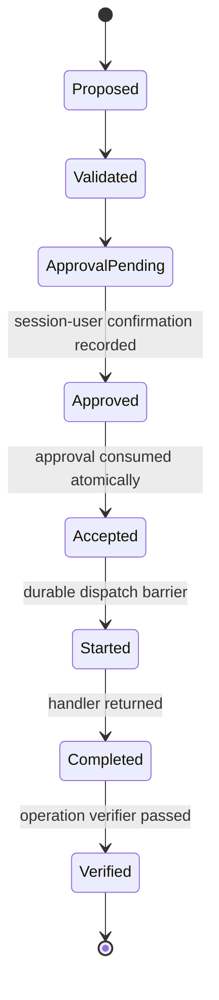

# WinForge Action Broker V2 — Durable Execution and Recovery

**Status:** Recovery rules are modeled and tested hostlessly. No V2 journal, durable store, service, handler, or real recovery mechanism is implemented.  
**Rule:** Missing evidence is uncertainty, not proof that an operation did not happen.
**Canonical model:** The transition table in [Architecture Remediation §6](./ACTION_BROKER_V2_ARCHITECTURE_REMEDIATION.md#6-canonical-lifecycle-state-machine) is normative. This document must not define alternate legal transitions.

## 1. Goals and non-goals

Design durable request transitions so the broker can explain accepted, started, completed, verified, cancelled, failed, interrupted, and recovery-required outcomes after service/application failure. This design cannot guarantee atomicity between a durable journal and an external Windows side effect. Exactly-once execution across an arbitrary crash is not assumed.

V1 remains independent: it is an in-process synthetic simulation with local JSON journaling. Its interrupted-start record does not establish recovery of V2 or any real system state.

## 2. Canonical states and transition authority

The canonical state machine and full per-transition rules are maintained in [Architecture Remediation §6](./ACTION_BROKER_V2_ARCHITECTURE_REMEDIATION.md#6-canonical-lifecycle-state-machine). The states are `Proposed`, `Validated`, `ApprovalPending`, `Approved`, `Accepted`, `Started`, `Completed`, `Verified`, `Rejected`, `Expired`, `Cancelled`, `Failed`, `Interrupted`, `RecoveryRequired`, and `Reconciled`.

Important invariants:

- `Accepted` consumes approval durably but does not dispatch a handler.
- Dispatch is impossible until the dispatcher observes a committed `Started` event and state version. No callback, queue, retry worker, or recovery path may bypass this barrier.
- With a valid ledger, `Accepted` without `Started` proves no dispatch under that invariant; close as `Cancelled`/`RestartBeforeDispatch`, keep approval consumed, and require a new proposal. If ledger integrity or durability is uncertain, use `RecoveryRequired`.
- `Started` without durable terminal handler outcome transitions through `Interrupted` to `RecoveryRequired` and must not replay. External effects may or may not have occurred.
- `Completed` is handler-reported completion only. `Verified` requires the operation's independent-verification contract.
- `Failed` and `Cancelled` are permitted only when the operation contract proves a known outcome; otherwise use `RecoveryRequired`.
- `RecoveryRequired` retains a durable target/resource fence. It is not cleared by timeout, restart, journal cleanup, or user dismissal.
- Recovery/rollback is separately authorized and journaled; there is no generic rollback or automatic handler retry.

## 3. Durable transition rules

Append an immutable event and update the current state projection atomically, guarded by expected state/version and unique identifiers. A transaction commit is the durable boundary; a client response is not. If the selected store cannot provide the required durability/consistency, the host must not dispatch.

The normative actors, preconditions, authorization, event, crash, retry, and recovery semantics for every transition are in the remediation transition table. Every implementation must test the table as a model; this companion document must not add states or alternate transitions.

### Normal path

### Crash / uncertain effect

```mermaid
stateDiagram-v2
    Accepted --> Cancelled: valid ledger proves no Started / no dispatch
    Accepted --> RecoveryRequired: ledger or dispatch invariant uncertain
    Started --> Interrupted: restart finds no terminal handler result
    Interrupted --> RecoveryRequired: fence before reconciliation
    Completed --> RecoveryRequired: verification unavailable/contradictory
    RecoveryRequired --> Reconciled: authorized disposition + evidence verified
    RecoveryRequired --> RecoveryRequired: unresolved; keep target fenced
    Reconciled --> [*]
```

Missing completion evidence never proves that an external effect did not occur. A crash between an external effect and its result commit remains ambiguous even if the target appears changed.

## 4. Hostless per-step durability model

The `RecoveryPlan` contract records a plan ID/version/request ID, a target identity, and ordered, uniquely identified steps. Each step has a versioned operation-specific procedure identity, explicit dependencies, precondition descriptors, expected-effect descriptors, and a retry classification. Dependencies must exist and precede the dependent step; intent can be modeled only with a matching current target, satisfied preconditions, and independently verified dependencies. These descriptors are contract labels only; they do not resolve or modify a real target.

Each `RecoveryStepAttempt` has its own ID and attempt number. The states are:

| State | Meaning / crash treatment |
|---|---|
| `Planned` | No durable intent exists; the step was never started. Recovery may leave it not started, but does not infer a procedure ran. |
| `IntentRecorded` | Intent must be durably committed before dispatch in any future host. If termination follows, the effect may be partial; reconcile and do not replay. |
| `Completed` | Completion evidence was recorded, but independent verification is still absent. A crash or contradictory result requires reconciliation, not rerun. |
| `IndependentlyVerified` | The model received passed postcondition evidence marked as an independent source. This label is not proof that a future source is actually independent. |
| `FailedKnownNoEffect` | Evidence claims the procedure had no effect. A new attempt is allowed only when the step's retry policy permits it and fresh authorization is supplied. |
| `OutcomeUnknown` / `RecoveryRequired` | Outcome is ambiguous or recovery is required. No transition back to intent exists; maintain a target fence and reconcile. |

The deterministic fake commit stores and commit-failure injection exist only under `tests/WinForge.UnitTests/ActionBrokerV2`. They exercise before/after model commit windows, including lifecycle, recovery-step, and rollback transitions. A before-commit failure leaves prior in-memory state; an after-commit failure reports an indeterminate response while the fake ledger contains the new state. This tests model ordering/query behavior only. It does not prove filesystem/database atomicity, flush semantics, power-loss durability, external side-effect atomicity, or anti-rollback. No fake store or persistence interface ships in the V2 library.

Modeled completion and known-no-effect evidence must name the step's declared procedure as their source; modeled verification must identify that same procedure as the executor and satisfy the separate-evidence-source criteria. These checks prevent inconsistent contract labels from passing the pure rules; they do not authenticate a component or establish real-world independence. The tests use synthetic IDs only.

Retry is a new attempt identity, permitted only from `FailedKnownNoEffect` under an explicit `RetryOnlyAfterKnownNoEffectAndFreshAuthorization` policy and fresh authorization. `OutcomeUnknown`, `RecoveryRequired`, and completed-but-unverified attempts cannot be replayed automatically.

## 5. Recovery after termination

### Startup sequence

1. Acquire exclusive broker-instance/ledger lock and establish an instance epoch.
2. Validate schema version, event sequence, event hashes/signatures/checkpoints, clock metadata, and backups. Any unexplained corruption or rollback is a hard readiness failure; do not treat it as an empty journal.
3. Load unresolved `Accepted`, `Started`, `Completed`-but-unverified, `Interrupted`, and `RecoveryRequired` records. For `Accepted` with no `Started`, apply the dispatch-barrier rule below; do not treat it like an uncertain started operation.
4. Persist a recovery-start record before doing reconciliation.
5. Transition every `Interrupted` request to `RecoveryRequired` and persist its target fence before reconciliation. Invoke only its bounded, read-only reconciliation contract from that state. Do not rerun the state-changing handler.
6. If independent evidence establishes an operation-specific recovery disposition and all fence-release conditions, persist `RecoveryDisposition` and `RecoveryVerified`, then transition `RecoveryRequired → Reconciled`. Record observed desired state without attributing it to the interrupted request unless evidence supports that attribution. If the operation contract proves no effect and permits a new request, reconcile the old request and require fresh preview/approval. If any ambiguity, partial state, or material attribution uncertainty remains, retain `RecoveryRequired` and the fence.
7. Mark service ready only when journal integrity and unresolved records are surfaced; “ready” does not mean all operations are safe to retry.

### Fault matrix

| Termination point | Durable evidence | Recovery response |
|---|---|---|
| Before `Proposed` commit | No broker request | Client may create a new proposal; no execution was accepted. |
| After `Proposed`/`Validated`, before approval | No handler dispatched | Expire/retain proposal; no execution retry concern. |
| After approval, before `Accepted` | Approval may exist, not consumed | On restart, revalidate expiry/session/policy; require fresh consent if state/version changed. |
| During `Accepted` transaction | Atomic transaction commits or rolls back | Query ledger by broker ID/idempotency key. If commit status is indeterminate due storage recovery, do not dispatch; reconcile and fence. |
| After `Accepted`, before `Started` | A valid ledger plus the enforced dispatch barrier proves the handler was not dispatched. If ledger integrity/durability is uncertain, this proof is unavailable. | Valid ledger: append `Cancelled/RestartBeforeDispatch`, keep approval consumed, and require a new proposal. Uncertain ledger: `RecoveryRequired`. Never reuse approval. |
| After `Started`, before/during side effect | Effect may or may not have occurred | `Interrupted` → `RecoveryRequired`; persist fence before read-only revalidation; never infer no-op or rerun. |
| After effect, before `Completed` | External effect may have occurred | Reconcile actual target; verify or require recovery. |
| After `Completed`, before `Verified` | Handler returned; postcondition unproven | Re-run only the operation-specific read-only verifier if safe; never rerun handler. If unverifiable or contradictory, `RecoveryRequired`. |
| After `Verified`, before client response | Terminal state exists | Client retrieves same result; no new execution. |
| During rollback/recovery | Undo may be partial | Keep `RecoveryRequired`, fence conflicts, report uncertainty; no chained automatic retry. |

Power loss and storage hardware may violate assumptions about flush durability. The implementation must select durable database settings, test them on supported filesystems, and document residual hardware/OS guarantees; a successful application-level write is not a universal proof against device/controller failure.

## 5. Cancellation, deadlines, and partial effects

- Record deadline, accepted cancellation, and handler checkpoint. A timeout is a signal to stop waiting, not proof of termination.
- Handler contracts declare cancellation points and whether cancellation is safe before/after each side effect.
- Before side effects, cancellation may become `Cancelled` only if the handler proves it was not dispatched or made no change.
- After any non-transactional side effect, cancellation requires read-back and possibly `RecoveryRequired`.
- A client disconnect is not cancellation. A service shutdown does not discard accepted work.
- If the handler cannot report an exact result, record a bounded error code and treat effect state as uncertain.
- Partial effects require an operation-specific recovery outcome, not a generic “failed” label.

## 6. Reconciliation and target fencing

The broker maintains a durable conflict/fencing record for an unresolved target. New proposals may be displayed, but execution for conflicting target/action classes is denied until reconciliation closes the fence. A fence is not removed by timeout, process restart, user dismissal, or journal cleanup.

Reconciliation must be read-only and narrowly scoped: query stable target identity and expected state using the operation's verifier. If the target is missing, replaced, inaccessible, or ambiguous, retain `RecoveryRequired`. If the result suggests the effect happened, do not assume it was caused by this request; preserve that attribution uncertainty.

## 7. Operation-specific execution and recovery contract

Every proposed operation must provide a versioned contract before it can enter any executable allowlist. The contract is descriptive and testable; this design defines no actual Windows-changing action. For verifier-independence levels, use [Architecture Remediation §7](./ACTION_BROKER_V2_ARCHITECTURE_REMEDIATION.md#7-verifier-independence).

| Contract element | Required definition |
|---|---|
| Identity and privilege | Stable operation ID/version, caller scope, required service identity/access rights, protected-component exclusions, and explicit deny cases. |
| Preconditions | Required state, freshness/age limits, evidence sources, policy/catalog versions, dependencies, and conditions that abort before start. |
| Target resolver | Exact stable target identity, disambiguation rules, replacement/reparse/alias handling, scope and ownership checks, and revalidation at proposal, approval, acceptance, and immediately before start. |
| Normalized request/effect | Typed parameter schema, canonical form, maximum sizes, expected effect and bounded preview. No executable strings or client-selected handlers. |
| Execution semantics | Side-effect steps, transaction boundary if any, idempotency semantics, durable checkpoints, maximum duration, cancellation points, resource conflicts, and what constitutes an uncertain outcome. |
| Independent verification | Assurance class, read-only postcondition source, evidence format, freshness, shared dependencies, and handling of inaccessible/contradictory data. Handler return alone is never verified state. |
| Reversibility / rollback eligibility | Classify as Reversible, Compensable, Irreversible, or Unknown; define exact pre-state, time window, dependencies, user-data risk, and deny conditions. |
| Rollback procedure | Exact typed compensating steps, authorization scope, own checkpoints, cancellation behavior, and side effects. Generic inverse operations are not accepted. |
| Rollback verification | Independent checks that the specified prior state was restored; explicit partial/unknown results. A rollback attempt is not a successful rollback until verified. |
| Recovery/partial failure | State mapping for every failure point; read-only reconciliation; when to fence the target; human decision/escalation path; and conditions that permanently prohibit retry. |

Rollback is never generic. If a state-changing operation is Irreversible/Unknown or has no safe recovery disposition, it is prohibited under the current design. A separately approved exception would require a new architectural/security decision. A compensating action is not exact rollback; rollback is successful only when independent evidence confirms the declared prior state. Rollback failure or uncertainty remains `RecoveryRequired`; the original request does not authorize broader repair.

The hostless rollback rules likewise require outcome evidence to identify the declared rollback procedure and verification to identify that procedure as the executor. Non-lifecycle recovery/rollback audit events require step, attempt, and evidence-digest references. These digest fields are correlation labels only: the model provides no append-only, tamper-proof, or authentic audit storage.

## 8. Database and journal requirements

- Any future V2 runtime uses a distinct authorization ledger, separate from V1 JSON and ordinary client-writable app data. Host and database technology remain undecided; SQLite is a candidate, not an accepted guarantee.
- Store event rows append-only at the application/API level, state snapshots/materialized view with event sequence, unique request/approval/execution IDs, canonical request digest, owner/session metadata, and verification/recovery evidence references.
- Use atomic transactions for state/event/approval consumption. Enforce uniqueness and legal transitions in constraints and broker code.
- Protect files, WAL/SHM, backups, and keys with service-identity ACLs. Backups preserve ordering and integrity metadata; restore runs a validation/reconciliation procedure before service readiness.
- Never store secrets unnecessarily. Encrypt only where threat/privacy review requires it; encryption does not prove record integrity.
- Define retention, export, repair, and deletion rules before deployment. Audit retention policy cannot silently erase unresolved execution evidence.
- Local transactions, ACLs, timestamps, protected keys, and hash chains do not provide strong rollback resistance against a local administrator or compromised host. The trust assumptions and witness/TPM candidate limits are in [Architecture Remediation §5](./ACTION_BROKER_V2_ARCHITECTURE_REMEDIATION.md#5-anti-rollback-authorization-state). Until a separately controlled anti-rollback mechanism is chosen, fail closed on unexplained state regression and prohibit operations that depend on proving prior approval consumption across rollback.

## 9. V1/V2 migration

1. V1 remains the default simulation path and keeps its JSON format and semantics.
2. Any future V2 host, if separately approved, starts without operation handlers and has a distinct authorization schema/database namespace.
3. No V1 request, approval, journal event, or simulation snapshot migrates into V2 authority.
4. UI integration, if later approved, shows explicit separate modes and requires a fresh V2 proposal and approval.
5. Existing V1 behavior remains available if V2 is absent, but no V2 request may silently fall back to V1.
6. Any future V1 format migration is a separate compatibility task; this design does not alter SQLite migrations 1–5 or V1 files.
