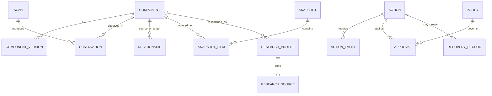

# WinForge — Database Design Specification

**Version:** 1.0  
**Database:** SQLite  
**Status:** Initial logical design

---

# 1. Purpose

This document defines the database principles and logical data model for WinForge.

The database stores current inventory, component identities, relationships, observations, history, research, policies, actions, recovery records and audit events.

It is a local knowledge store, not an unrestricted dump of all information on the computer.

# 2. Core Design Principles

- Use SQLite as the initial persistence engine.
- Use versioned schema migrations from the first release.
- Separate current state from historical observations.
- Preserve history when software or devices change.
- Use stable internal IDs.
- Store provenance and confidence with discovered facts.
- Keep high-frequency monitoring data bounded.
- Use transactions for logically related writes.
- Never treat a failed scan as proof that an item was removed.
- Never allow database content to authorize privileged operations.

# 3. Logical Domains

1. Database metadata and migrations.
2. Inventory.
3. Component identity.
4. Hardware and devices.
5. Drivers.
6. Software.
7. Processes and services.
8. Startup entries and scheduled tasks.
9. Digital Twin relationships.
10. Observations and resource samples.
11. Snapshots and change journal.
12. Research.
13. User preferences and exclusions.
14. Guardian policies and approvals.
15. Actions and audit.
16. Recovery and backups.

# 4. Entity and Relationship Overview

This is a logical relationship diagram, not a final physical schema.

# 5. Identifier Strategy

Use internal UUIDs or another stable generated identifier for database entities.

Do not use a filename, display name, process ID or path as the sole primary key.

Keep distinct:
- `component_id`: stable logical entity.
- `version_id`: a particular observed version or package state.
- `observation_id`: a particular observation.
- `device_instance_id`: a particular device instance where available.
- `scan_id`: a collection run.
- `snapshot_id`: a point-in-time state capture.
- `action_id`: an operation request and lifecycle.

Process IDs are reusable and must be paired with process start time or another process-instance identity.

# 6. Core Tables

The following are logical table definitions. Final column types, constraints and indexes must be established during implementation and documented in migrations.

## 6.1 `schema_migrations`
Tracks applied migration identifiers, version, timestamp and checksum.

## 6.2 `scans`
Records scan ID, collector, scope, start/end time, status, permissions, coverage and error summary.

## 6.3 `components`
Stores stable component identity, component type, normalized identity key, display metadata, first seen, last verified and lifecycle status.

## 6.4 `component_versions`
Stores version-specific data such as product version, file version, package version, publisher, signature state, package identifiers and relevant hashes.

## 6.5 `component_paths`
Stores normalized paths associated with a component, path role, observed time and last verified time. Avoid treating paths as globally unique identities.

## 6.6 `devices`
Stores PnP instance ID, hardware IDs, compatible IDs, class, manufacturer, model, status and parent relationships.

## 6.7 `driver_packages`
Stores INF name, provider, version, date, signer, signature status, package metadata and export status.

## 6.8 `software_installations`
Stores product/package identity, installation scope, version, publisher, install source where known and uninstall metadata.

## 6.9 `process_instances`
Stores process identity, PID, start time, executable component, parent relationship and observed lifetime. Avoid retaining unnecessary command-line data.

## 6.10 `services`
Stores service name, display name, start type, state, executable association, service account classification where needed and last verification.

## 6.11 `startup_entries`
Stores startup mechanism, entry identity, target component, enabled state and provenance.

## 6.12 `scheduled_tasks`
Stores task path/name, state, trigger metadata summary, action target association and last verification. Avoid storing sensitive task arguments unless required.

## 6.13 `relationships`
Stores source component, target component, relationship type, direct/inferred classification, confidence, validity and last verification.

## 6.14 `relationship_evidence`
Stores evidence type, source collector, source record, collection time, evidence summary and reliability.

## 6.15 `observations`
Stores component state observations with timestamps, scan reference, provenance and status.

## 6.16 `resource_samples`
Stores bounded CPU, memory, disk, network and supported sensor measurements. Define sampling interval and retention by monitoring profile.

## 6.17 `snapshots`
Stores snapshot ID, creation time, scope, status and source.

## 6.18 `snapshot_items`
Stores normalized component state captured by a snapshot. Use stable component references and a versioned serialization format where structured payloads are necessary.

## 6.19 `change_events`
Append-only journal of observed changes: event type, component, previous state reference, new state reference, time, source and confidence.

## 6.20 `research_profiles`
Stores component identity, researched version, first research time, last verification, freshness and research status.

## 6.21 `research_sources`
Stores source URL, publisher/domain, retrieval time, publication date when known, source type and reliability classification.

## 6.22 `research_claims`
Stores a concise claim, supporting source references, confidence, applicability and verification state.

## 6.23 `user_preferences`
Stores application preferences and user-selected modes.

## 6.24 `exclusions`
Stores components, paths or operations explicitly excluded by the user, scope and creation time.

## 6.25 `guardian_policies`
Stores policy ID, version, scope, operation class, allowed risk level, approval requirement and enabled state.

## 6.26 `approvals`
Stores approval ID, action ID, exact target identity, exact parameter digest, policy version, approver identity, creation and expiry, and consumption status.

## 6.27 `actions`
Stores action type, target, parameters in a typed and validated representation, requested time, authorization result, execution state and verification result.

## 6.28 `action_events`
Append-only lifecycle events: proposed, analyzed, approved, rejected, started, completed, failed, cancelled, verified and recovery initiated.

## 6.29 `recovery_records`
Stores recovery type, scope, location, creation time, integrity status, verification status and restoration limitations.

## 6.30 `audit_events`
Stores security-relevant events with timestamp, actor, operation, target, result and correlation ID. Avoid logging secrets or unnecessary personal data.

## 6.31 Action Broker V1 design tables

These logical records are design guidance for a future separately hosted privileged broker, not the current runtime persistence schema. The simulation runtime stores its execution journal and state snapshot in local JSON files under `%LOCALAPPDATA%\WinForge`; it does not use SQLite for Action Broker history and is not tamper-proof. No Action Broker database migration is required for the simulation-only release. A future privileged implementation may maintain the following logical records:

- `action_requests`: request id, action id, target identity digest, parameter digest, approval token id, risk class, created at, expires at, and state.
- `action_approvals`: approval id, action request id, policy version, approver identity, target identity, parameter digest, preview hash, expiry, and one-time-use status.
- `action_executions`: operation instance id, request id, handler id, started at, ended at, status, verification result, and journal reference.
- `action_journal`: append-only lifecycle events for proposed, validated, approved, rejected, started, interrupted, verified, rolled back, and failed states.
- `action_verification`: state checks, expected values, actual values, verification timestamp, and constraint violation notes.

The design requires:
- request-bound authorization,
- stale target rejection,
- replay prevention,
- protected-component checks,
- explicit rollback metadata when supported,
- tamper-evident audit entries.

No database migration is introduced for the current simulation-only implementation. Historical SQLite migrations remain unchanged.

The V2 proposal requires a broker-owned durable authorization/execution ledger, but does not select or implement its storage engine or schema. Any V2 schema, migration, key storage, anti-rollback checkpoint, and retention rules require separate approval and must not reuse the V1 local JSON journal or alter historical SQLite migration definitions without an independently reviewed implementation proposal. See [ACTION_BROKER_V2_RECOVERY.md](../../ACTION_BROKER_V2_RECOVERY.md).

# 7. Identity and Reconciliation

A component identity may combine:
- Package identifier.
- MSI product code.
- Publisher and signing identity.
- Hardware ID.
- Normalized installation path.
- Product and file metadata.
- Service or task identity.
- Version and hash evidence.

Do not combine unrelated products just because their names match.

When a version changes:
1. Reconcile the logical product identity.
2. Create or update version-specific records.
3. Preserve the previous version.
4. Record the source and timestamp.
5. Update relationships affected by the change.

A hash change does not automatically prove a different product. A matching filename does not prove the same product.

# 8. Current State and Historical State

Current-state tables represent the latest verified view.

Historical tables preserve observations and changes.

A scan that cannot access a component must not mark it removed. Use explicit states such as:
- Current.
- Stale.
- Inaccessible.
- Missing from latest scan.
- Removed with sufficient evidence.
- Unknown.

# 9. Transactions and Concurrency

Use transactions for:
- Scan result persistence.
- Snapshot creation.
- Identity reconciliation.
- Action lifecycle transitions.
- Approval consumption.
- Recovery record creation.

Adopt a deliberate SQLite concurrency strategy:
- Prefer a single-writer queue for application writes.
- Keep read operations separate where appropriate.
- Use WAL only after validating the chosen deployment and backup strategy.
- Configure a bounded busy timeout.
- Keep transactions short.
- Retry only safe, idempotent operations.
- Never silently drop failed writes.

# 10. Retention and Storage

Define configurable retention for:
- High-frequency resource samples.
- Process observations.
- ETW-derived events.
- Scan history.
- Snapshots.
- Audit events.

Do not automatically purge security audit records or recovery metadata without a documented policy.

Use aggregation for older monitoring samples where appropriate.

# 11. Backups and Integrity

- Use a consistent SQLite backup mechanism.
- Do not copy a live database file naively while WAL data may be active.
- Verify backup integrity.
- Store backups separately from the active database when possible.
- Version backup formats.
- Test restore into a disposable location.
- Never overwrite the only valid database backup during an upgrade.

# 12. Data Protection and Privacy

- Restrict database file permissions.
- Do not store passwords or credentials.
- Avoid collecting private document contents.
- Avoid retaining full command lines unless a specific feature requires them.
- Redact personal paths in exported reports where appropriate.
- Keep external transmission disabled by default.
- Make export scope visible to the user.

# 13. Migration Rules

Every schema change must:
1. Have a unique migration ID.
2. Be ordered and deterministic.
3. Be transactional where possible.
4. Preserve existing data.
5. Include rollback or documented forward-recovery strategy.
6. Have migration tests.
7. Be tested against a copy of a previous-version database.

Never edit an already released migration. Add a new migration.

# 14. Database Testing

Test:
- Fresh database creation.
- Every migration path.
- Upgrade from previous versions.
- Foreign-key enforcement.
- Duplicate identity handling.
- Partial scan persistence.
- Interrupted transactions.
- Concurrent reads and writes.
- Busy timeout.
- WAL recovery.
- Backup and restore.
- Corruption detection.
- Retention jobs.
- Large inventory performance.

# 15. Open Design Decisions

Before finalizing the physical schema, document decisions for:
- UUID representation.
- JSON payload use versus normalized columns.
- Encryption requirements based on the threat model.
- Resource-sample retention defaults.
- Audit retention.
- Multi-user Windows machine behavior.
- Database location and ACLs.
- Backup location and rotation.

Do not add encryption merely as a checkbox. Define the threat it addresses, key management and recovery implications first.

# 16. Initial Physical Schema

The first application migration (`migration_id = 1`) implements the following subset of the logical model:

- `schema_migrations`: ordered migration identifier, SHA-256 checksum, and application time.
- `scans`: scope, start/completion time, status, and attempted/total collector counts.
- `components`: stable UUID, component type, type-scoped identity key, display name, provenance, and first/last verification times.
- `observations`: scan and component references, observation time, details schema version, and structured JSON details.
- `collector_issues`: collector identifier, error code, and user-safe failure summary.

The migration creates indexes for scan history and component observation lookup. Scan completion, component reconciliation, observations, and issues are written in one transaction. A partial, failed, or cancelled scan does not delete components that were previously observed.

For this implementation, UUIDs are canonical text values and component detail payloads use JSON schema version `1`. The database is located under the interactive user's Local Application Data directory. SQLite foreign-key enforcement is enabled for every connection, writes use a bounded busy timeout, and the database uses WAL mode. Backups use the SQLite online backup API and are integrity-checked before the operation reports success.

This is an initial implementation subset, not the final physical schema. Multi-user behavior, retention defaults, database ACL hardening, backup rotation, and any encryption decision remain open.

## 16.1 Migration 2 — hardware category and observation details

Migration 1 is immutable. Migration 2 is applied transactionally and:

- Adds `components.category TEXT NOT NULL DEFAULT 'General'` and an index for category navigation. Existing component rows retain their IDs and receive the compatible `General` category.
- Continues to store source-specific hardware details in each observation's JSON payload rather than duplicating every hardware property into fixed columns.
- Supports observation details schema version `2`, containing the details dictionary, per-field availability state, observed display name, category, and source. Capturing those values in the observation payload preserves historical metadata when the current component row is refreshed.
- Continues to read version `1` observations as their original details dictionary; null legacy values map to `Unknown` because their old meaning cannot be reconstructed.

Field availability values are `Unknown`, `Available`, `Missing`, `Unavailable`, `Unsupported`, and `Inaccessible`. `Missing` means the collecting interface did not report that field; it is not a claim that the hardware is absent. New device categories include motherboard, BIOS, graphics, storage, network, display, audio, battery, and aggregate memory. Existing stable component identity and `UNIQUE (component_type, identity_key)` reconciliation remain in force.

For comparison, the repository loads the two latest scans with results (`Completed` or `Partial`) in the same scope as the latest successful scan. Failed/cancelled scans are not comparison baselines. Interleaved hardware, software, and system scans therefore do not create false “not observed” comparisons against a different inventory group. UI comparison can report new/changed/unchanged observations and items not observed in a comparable scan; it never deletes old records or claims removal based only on absence. Historical comparisons from old schema-1 observations use the current component row for display metadata because that prior schema did not snapshot display name/category/source.

Migration tests upgrade a schema-1-shaped database, verify its component and observation survive, and round-trip version-2 category and field states. A newer application schema is rejected by older binaries rather than silently interpreted.

## 16.2 Deep hardware inventory

PC Passport v3 adds driver-package, storage-health/NVMe, EDID display, detailed audio endpoint, input-device, firmware-mode, and thermal-sensor component types. This does not require another physical migration: `component_type` is stored as text, while component-specific values and availability states are stored in the existing version-2 observation JSON. Existing migration checksums and migration 1/2 definitions remain unchanged. Current scans continue to append observations, and partial/unsupported collectors do not delete previously stored components.

Driver package identity is keyed by the published INF when available. Device IDs associated with one package are joined in `associatedDeviceIds` during scan reconciliation so a shared package is not reduced to a single observed device. NVMe health components are keyed by PnP device identity where available; raw 128-bit NVMe counters are stored as decimal text to avoid narrowing or rounding. `Unknown`, `Missing`, `Unavailable`, `Unsupported`, and `Inaccessible` remain distinct in historical observations.

## 16.3 PC Passport v4 — software and system observations

Installed applications, services, processes, startup entries, scheduled tasks, Windows updates, optional features, environment variables, and OS/boot/activation information use the existing `components` and `observations` records. The component type discriminator remains text and each source-specific field and availability state is stored in the existing version-2 observation JSON. No new SQLite migration is required; migration 1 and 2 SQL and checksums remain immutable, and version-1/2 databases remain readable.

The scan scope identifies All, Hardware, Software, or System collection. Comparison baselines are selected only from the same exact scope as the most recent successful scan, preventing an independent software scan from marking hardware as missing (or vice versa). Observation history remains append-only. A failed, cancelled, partial, unsupported, or inaccessible scan never deletes known component records. Source and per-component observation time are persisted with each observation.

Process identity uses PID plus the start-time ticks when available; command lines are not collected. Application registration and startup command arguments are omitted. Scheduled-task action arguments and service executable arguments are omitted. The environment collector reads only its documented allowlist rather than persisting arbitrary environment contents. Store/AppX packages and other-user profiles are not represented as if they were observed.

Migration tests continue to validate schema-1 upgrade, schema-2 availability round-trip, historical observations, backup integrity, and cross-scope comparison behavior. New software/system component types round-trip without a schema change.

## 16.4 Recovery discovery observations

Recovery discovery is an independent scan scope persisted through the existing `components`, `observations`, `scans`, and issue records. Recovery component types and source-specific details remain text/JSON payloads in the version-2 observation format. Each item records its data source and collection timestamp alongside explicit availability, status, confidence, warnings, and limitations. **No SQLite migration is required**; migration 1 and 2 definitions and checksums remain unchanged.

Recovery scans do not reconcile absence as removal. Partial, failed, cancelled, inaccessible, or unsupported source results retain prior observations. Comparisons are scoped to Recovery scans only, so interleaved hardware/software/system scans do not imply recovery-component loss. Existing databases remain readable without conversion.

## 16.5 Migration 3 — Digital Twin snapshots

Migration 3 adds `digital_twin_snapshots`, `digital_twin_entities`, and `digital_twin_relationships`, with indexes for snapshot history, entity browsing, and relationship traversal. Snapshot metadata stores the inventory watermark, record counts, and SHA-256 checksum. Entities and evidence-backed relationships are written transactionally, and repository reads verify checksums, record counts, and relationship endpoints before returning a snapshot.

Migration 1 and 2 definitions and checksums remain unchanged. The migration is additive; existing inventory scans, components, observations, and databases remain readable. Unit/integration tests cover the previous schema upgrade paths, persistence round-trip, historical snapshots, and tamper detection.

Recovery readiness findings are derived from existing Recovery observations and are not separately persisted. Guardian telemetry persistence is implemented by additive migration 5 below.

## 16.6 Migration 4 — Backup inspection history

Migration 4 adds `backup_inspections` with a primary inspection ID, candidate identity, provider, optional local location, start/completion timestamps, explicit inspection state, summary, recognized-structure flag, bounded metadata counters, JSON check evidence, and limitations. An index on candidate identity and completion time supports bounded history and latest-versus-previous comparisons. The repository caps serialized inspection evidence at 64 KiB and history queries at 100 rows.

Migration 1, 2, and 3 SQL definitions and checksums remain unchanged. Migration 4 is additive and is applied transactionally to fresh databases and schema-1, schema-2, and schema-3 databases. Inspection writes do not replace inventory observations or duplicate large backup payloads. Inspection history contains metadata only; no backup file contents are copied into SQLite.

## 16.7 Migration 5 — Guardian telemetry history

Migration 5 adds `guardian_telemetry_samples(sample_id, collected_utc, payload_json)` and an index on `(collected_utc DESC, sample_id DESC)`. Each bounded JSON record contains the timestamped system CPU, physical-memory, fixed-volume, uptime, network, process, and GPU-adapter observations, including source, availability, intervals where applicable, and limitations. The repository validates the shape and metadata, caps each payload at 64 KiB, and commits insertion plus retention pruning in one transaction.

The user-controlled retention policy is bounded to 1–365 days and 100–100,000 samples (default 30 days/25,000 samples). Time-range queries are indexed and capped at 10,000 samples; the UI limits summaries and recent sample rows. Large raw inventory payloads are not duplicated into the telemetry table. Network rates are measured counter deltas rather than persisted cumulative network counters; process identities use PID and start ticks where available. GPU adapter identity may be retained, but unsupported measurements are stored as explicit unavailable states, never as zero.

Migration 1–4 SQL definitions and checksums remain unchanged. Migration 5 is registered once and applied transactionally to fresh databases and schema-1 through schema-4 databases. A database write failure is surfaced to the user while the live sample remains displayable; the failed sample is not represented as persisted history.
