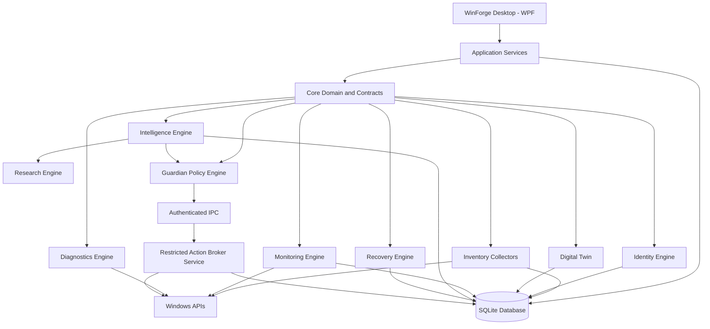

# WinForge — Architecture Specification

**Version:** 1.0  
**Status:** Initial engineering baseline  
**Platform:** Windows 11 x64  
**Primary language:** C#  
**Application framework:** .NET 10 LTS + WPF  
**Database:** SQLite

---

# 1. Purpose

WinForge is a local-first Windows maintenance, system intelligence, diagnostics, optimization, automation and recovery platform.

Its architecture must allow it to:

- Discover and catalogue the computer.
- Maintain persistent component identities.
- Understand relationships between system components.
- Monitor system behaviour.
- Identify potential problems.
- Research unknown components.
- Recommend evidence-backed improvements.
- Simulate the impact of proposed changes.
- Execute approved operations safely.
- Verify results.
- Record changes and support recovery.

The application must be modular, secure, testable, maintainable and extensible.

# 2. Architectural Principles

1. Local-first by default.
2. Least privilege.
3. Explicit security boundaries.
4. Evidence-backed intelligence.
5. Deterministic authorization.
6. Reversible operations where possible.
7. Independent modules with clear responsibilities.
8. No arbitrary privileged command execution.
9. No AI-controlled administrative authority.
10. No silent system modifications.
11. No fake functionality.
12. No unsupported Windows API assumptions.

# 3. High-Level Architecture

WinForge consists of these logical systems:

1. Desktop Application
2. Core Domain
3. Application Services
4. Inventory Collectors
5. Identity Engine
6. Database and Persistence
7. Digital Twin
8. Monitoring Engine
9. Intelligence Engine
10. Research Engine
11. Guardian Policy Engine
12. Action Broker
13. Recovery Engine
14. Diagnostics Engine
15. External Integrations



This diagram describes logical responsibilities. It does not require every module to run in a separate process.

# 4. Technology Stack

| Area | Technology |
|---|---|
| Language | C# |
| Framework | .NET 10 LTS |
| Desktop UI | WPF |
| UI architecture | MVVM |
| Database | SQLite |
| Logging | Microsoft.Extensions.Logging |
| Dependency injection | Microsoft.Extensions.DependencyInjection |
| Hosting | Microsoft.Extensions.Hosting where appropriate |
| Monitoring | ETW and Windows performance APIs |
| Hardware inventory | Configuration Manager, SetupAPI and supported Windows APIs |
| Device information | PnP and WMI/CIM |
| Services | Service Control Manager |
| Scheduled tasks | Task Scheduler APIs |
| Packages | Windows package APIs and supplemental WinGet |
| IPC | Unselected; named pipes are an ADR 0012 proposal only |

Verify SDK and runtime availability before implementation. Do not assume that a target framework is installed merely because it is specified here.

## 4.1 Dependency policy

Use established libraries only when they materially improve reliability or maintainability.

For each dependency evaluate its licence, maintenance status, security history, compatibility, runtime overhead and deployment requirements. Avoid unnecessary dependencies.

# 5. Project Structure

```text
WinForge/
├── WinForge.sln
├── src/
│   ├── WinForge.App/
│   ├── WinForge.Domain/
│   ├── WinForge.Core/
│   ├── WinForge.Application/
│   ├── WinForge.Contracts/
│   ├── WinForge.Infrastructure/
│   ├── WinForge.Database/
│   ├── WinForge.Collectors/
│   ├── WinForge.Identity/
│   ├── WinForge.DigitalTwin/
│   ├── WinForge.Monitoring/
│   ├── WinForge.Intelligence/
│   ├── WinForge.Research/
│   ├── WinForge.Guardian/
│   ├── WinForge.ActionBroker.Contracts/
│   ├── WinForge.ActionBroker.Service/
│   ├── WinForge.Recovery/
│   ├── WinForge.Diagnostics/
│   └── WinForge.Integrations/
├── tests/
│   ├── WinForge.UnitTests/
│   ├── WinForge.IntegrationTests/
│   ├── WinForge.DatabaseTests/
│   ├── WinForge.SecurityTests/
│   ├── WinForge.WindowsTests/
│   ├── WinForge.AcceptanceTests/
│   └── WinForge.PerformanceTests/
├── docs/
│   ├── SECURITY.md
│   ├── THREAT_MODEL.md
│   ├── DATABASE.md
│   ├── WINDOWS_APIS.md
│   ├── RECOVERY.md
│   ├── TESTING.md
│   ├── RELEASE.md
│   └── CHANGELOG.md
├── scripts/
├── .gitignore
├── README.md
└── LICENSE
```

This is a starting point. Do not create empty projects merely to match the diagram. Add projects when they have a genuine architectural responsibility.

# 6. Module Responsibilities

## 6.1 WinForge.App
Responsible for WPF interface, navigation, view models, user preferences, approval dialogs, notifications, reports and dashboards. Must not directly perform privileged Windows modifications.

## 6.2 WinForge.Domain
Contains domain entities, value objects, enums, identity definitions, policy models, domain events and business invariants. Must not depend on WPF or Windows-specific infrastructure.

## 6.3 WinForge.Core
Contains shared abstractions and core contracts where necessary. Avoid duplicating contracts between projects.

## 6.4 WinForge.Application
Contains application workflows, use cases, request validation, orchestration, result handling and domain coordination. Must not contain direct UI code.

## 6.5 WinForge.Database
Responsible for SQLite connection management, migrations, repositories, transactions, database integrity and persistence.

## 6.6 WinForge.Collectors
Responsible for read-only system inventory collection. Collectors should be independently testable.

## 6.7 WinForge.Identity
Responsible for software, driver and component identity; identity reconciliation; version history; and confidence.

## 6.8 WinForge.DigitalTwin
Responsible for nodes, relationships, relationship evidence, graph queries, dependency traversal and historical relationship validity.

## 6.9 WinForge.Monitoring
Responsible for resource samples, event-driven monitoring, monitoring profiles, sampling schedules, resource budgets and monitoring lifecycle.

## 6.10 WinForge.Intelligence
Responsible for local rules, recommendations, risk and confidence evaluation, change impact analysis, root-cause hypotheses and historical analysis.

## 6.11 WinForge.Research
Responsible for optional online research. It must run without administrative privileges. All retrieved content is untrusted.

## 6.12 WinForge.Guardian
Responsible for operating modes, permission scopes, risk policies, protected-component policies, approval validation and action authorization. It must not directly execute privileged operations.

## 6.13 WinForge.ActionBroker.Service
Responsible exclusively for authorized privileged operations. It must independently authenticate and validate every request.

## 6.14 WinForge.Recovery
Responsible for bounded read-only recovery discovery and backup inspection, configuration backups, driver exports, snapshot management, recovery records, restoration workflows and recovery verification. Keep provider-specific file inspection in Infrastructure behind Application contracts; keep readiness and inspection-result interpretation in Domain/Application. The current Backup Intelligence increment supports bounded Windows Image Backup metadata/signature checks and File History configuration metadata only, persists inspection evidence in SQLite, and does not establish full integrity or restoreability.

## 6.15 WinForge.Diagnostics
Responsible for Windows event analysis, device diagnostics, application failures, system health checks and diagnostic reports.

# 7. Privilege Architecture

WinForge must follow least-privilege principles.

## 7.1 Desktop process
Runs under the interactive user. It does not need administrator privileges for ordinary usage.

## 7.2 Monitoring service
Runs with the minimum permissions required by its collectors. Do not automatically use LocalSystem.

## 7.3 Action Broker
The accepted ADR 0011 requires a separate Windows service for future privileged operations, with a restricted operation registry and broker-authoritative authorization. The specific host/IPC design is not accepted: ADR 0012 remains Proposed, and the current V2 review has not established that any selected operation needs machine-wide hosting.

The broker must not accept arbitrary PowerShell, CMD, executable paths or scripts as generic administrative instructions.

### 7.3.1 Action Broker V1 design blueprint and current simulation

The design is intentionally narrow and remains documentation-only until a separate security review approves a privileged runtime. The broker contract is:

- typed operation registry with allowlist enforcement,
- request-bound authorization that is bound to action type, exact target identity, normalized parameters, policy version, and expiry,
- deny-by-default policy for protected components and unsupported operations,
- revalidation of the previewed target just before execution,
- prevention of replay and duplicate execution through request and correlation ids,
- lifecycle journaling of proposed, approved, started, interrupted, verified, failed, and rolled-back states,
- explicit rollback contracts and post-execution verification before any execution is marked successful,
- simulation-only security tests for malformed payloads, stale targets, replay attempts, and protected-component denial,
- no execution of arbitrary scripts, shell strings, or raw system commands.

The separate privileged-service design remains a blueprint only. The current codebase has an in-process simulation engine and WPF workflow, but no privileged implementation or system-changing runtime path.

### 7.3.2 Action Broker V2 separate-host proposal

The V2 review recommends a hostless contracts/model phase because no first V2 operation or machine-wide rights requirement is established. A per-user unelevated broker is only a candidate for a future user-scoped use case; a demand-start service and named pipes remain an unaccepted proposal in ADR 0012. ADR 0011's accepted service constraint remains in force for privileged operations unless a new ADR explicitly narrows or supersedes it. Trustworthy exact-preview human intent against same-user malware and strong local anti-rollback are not currently established, so consequential operations are prohibited. No V2 host, endpoint, elevation path, real executor, or authorized Windows-changing operation exists. See the root V2 review/remediation documents for the alternatives, identity model, lifecycle, and remaining gates.

## 7.4 Research worker
Runs without administrative privileges and must not receive access to privileged execution facilities.

# 8. Communication Architecture

**Status:** The named-pipe recommendation and envelope requirements formerly described in this section are stale planning text and are superseded for the current milestone by the hostless-first V2 plan. ADR 0012 remains Proposed; no host, transport, endpoint, or wire schema is selected.

The current V2 implementation is an isolated hostless model library and deterministic test suite. It defines no transport DTOs, framing, IPC, or request/response protocol. Any future host and transport require a concrete use case, rights analysis, a separate architecture decision consistent with ADR 0011, and independent review. Historical protocol examples in companion design documents remain illustrative only.

Validate message size, schema, caller identity, operation permissions, expiration, replay and duplicate requests, and target identity.

Never trust a client-supplied risk classification. The broker independently evaluates authorization.

# 9. Database Architecture

SQLite is the primary local persistence engine. Use normalized tables and versioned migrations.

## 9.1 Logical domains
- Metadata.
- Inventory.
- Identity.
- Devices.
- Drivers.
- Software.
- Processes.
- Services.
- Startup entries.
- Scheduled tasks.
- Volumes.
- Relationships.
- Relationship evidence.
- Observations.
- Resource samples.
- Snapshots.
- Snapshot items.
- Change journal.
- Research profiles.
- Research claims.
- Research sources.
- Guardian policies.
- Protected components.
- Preferences.
- Exclusions.
- Action requests.
- Approvals.
- Action results.
- Rollback records.
- Backup records.
- Audit events.

## 9.2 Database requirements
- Stable identifiers.
- Foreign keys.
- Appropriate indexes.
- Transactional operations.
- Migration versioning.
- WAL where appropriate.
- Integrity checks.
- Crash recovery.
- Backup support.
- Retention policies.
- Concurrent-access strategy.

Separate current state from historical state. Do not store unlimited high-frequency resource samples. Do not erase known inventory following a failed scan.

# 10. PC Passport Architecture

Inventory collectors should implement a shared contract:

```csharp
public interface IInventoryCollector
{
    string CollectorId { get; }

    Task<CollectorResult> CollectAsync(
        CollectorContext context,
        CancellationToken cancellationToken);
}
```

Each collector reports collector ID, collection time, scope, permission level, discovered records, errors, coverage and completion status.

Use incremental scans and targeted rescans. Inventory records must have last-verified timestamps. Distinguish current, stale, removed, inaccessible and unknown.

# 11. Identity Architecture

Use composite identities rather than filenames alone.

Identity evidence can include package identifiers, MSI product codes, publisher, digital signature, normalized paths, executable metadata, file hashes, version, service identity and hardware ID.

Maintain separate logical product identity and installed-version identity. A normal version update should not automatically create a new logical product. Identity confidence must be recorded.

# 12. Digital Twin Architecture

The Digital Twin is a graph backed by relational persistence.

The initial implementation builds immutable, evidence-based snapshots from PC Passport observations, persists them transactionally in SQLite, validates snapshot checksums on load, and bounds dependency traversal. Missing observations are represented as `NotObserved`, not as removals. The WPF explorer provides search, category filtering, entity evidence, historical snapshot selection, and dependency queries.

Node types: hardware, device, driver, application, executable, service, process, scheduled task, startup entry, configuration and volume.

Edge types: depends on, supports, starts, runs, installed by, associated with, uses package and connected to.

Every edge includes source, evidence, confidence, direct/inferred classification, last verified time and validity.

An association is not necessarily a dependency. When evidence expires, revalidate the edge or mark it uncertain.

# 13. Monitoring Architecture

Use a combination of ETW, performance counters, process APIs, device notifications, service notifications and periodic polling.

The current monitoring increment is a user-started, read-only Observer that samples system CPU, physical memory, fixed-volume capacity, uptime, network-interface throughput from counter deltas, bounded process CPU/working-set observations, and GPU adapter identities. All observations include availability, source, and limitations; GPU utilization, dedicated memory, and temperature remain Unsupported where no reliable portable source is used. Samples are stored locally through additive SQLite migration 5, with configurable age/count retention and bounded time-range queries. Sampling is cancellable and never starts automatically. Guardian policy, approvals, automated actions, ETW collection, and service/device-state monitoring are not implemented.

The Overview screen composes current persisted/in-memory view-model state only. It displays collection timestamps and known errors, warnings, and unavailable observations rather than calculating an unexplained health score. Historical analysis is query-bounded and reports observed sample statistics and gaps; it does not forecast exhaustion or hardware failure.

Monitoring profiles:
- Minimal.
- Balanced.
- Investigation.
- Maintenance.

Suggested starting sample intervals:
- Minimal: 30–60 seconds.
- Balanced: 5–15 seconds.
- Investigation: 1–5 seconds where supported and justified.
- Maintenance: adaptive.

These are configurable starting values, not fixed requirements. Use bounded queues and retention. Expose WinForge's own resource usage. Avoid permanent high-volume tracing.

# 14. Intelligence Architecture

Routine decisions use deterministic local rules.

The intelligence engine may consume inventory, identity, Digital Twin, monitoring, history, research and user preferences.

Recommendations must contain explanation, evidence, risk, confidence, expected benefit, possible downside, dependencies and reversibility.

Risk and confidence are independent. Optional AI can explain or research, but cannot authorize actions.

# 15. Guardian Architecture

Modes:
- Observer.
- Assistant.
- Guardian.

The Guardian evaluates permission, action type, risk, confidence, protected status, current workload, preconditions and recovery readiness.

The policy engine returns a structured decision, such as Allowed, Denied, RequiresApproval, RequiresMoreEvidence or RequiresRecoveryPreparation. Use typed enums and validated models, not unrestricted strings.

The Guardian policy engine and Assistant/Guardian modes are not implemented. The WPF shell includes a separate Action Broker tab for synthetic simulation only; neither that tab nor Observer telemetry authorizes real system-changing actions. Telemetry persistence is opt-in through explicit user-started sampling and is constrained by migration-5 retention limits.

# 16. Action Lifecycle

Every system-changing operation follows:

1. Proposal.
2. Evidence collection.
3. Impact analysis.
4. Risk evaluation.
5. Approval.
6. Precondition validation.
7. State capture.
8. Execution.
9. Verification.
10. Audit.
11. Recovery if required.

Operations must support cancellation and timeout where appropriate. Prevent conflicting concurrent operations against the same target. Where possible, use idempotent action handlers.

# 17. Recovery Architecture

Keep recovery mechanisms distinct:
- Configuration backup.
- Driver package export.
- Restore point.
- System image.
- Personal-file backup.
- Recovery media.

A snapshot is not automatically a backup. A backup is not automatically verified.

Every recovery record includes type, scope, creation time, location, integrity status, validation status and restoration limitations.

Never claim complete rollback if Windows or the underlying operation does not support it.

The current discovery scope checks only fixed backup-candidate directory names at ready mounted-volume roots. Inspection is user-selected, local-only, bounded, cancellable, and rejects reparse points. It reads supported metadata/signature evidence without changing or mounting backups. Passing a bounded check is not proof of completeness or recoverability; see `RECOVERY.md` and ADR 0009.

# 18. Windows Integration

Use supported interfaces wherever possible:
- Configuration Manager.
- SetupAPI.
- PnP APIs.
- Service Control Manager.
- Task Scheduler APIs.
- WMI/CIM.
- Registry APIs.
- Process APIs.
- ETW.
- Performance counters.
- Windows package APIs.
- Windows Security Center.
- WinGet.

Create `docs/WINDOWS_APIS.md` to document API name, purpose, supported Windows versions, required permissions, error conditions, limitations and alternative interfaces.

Do not invent API functionality. Do not assume information exposed through one Windows interface is complete.

# 19. Error Handling

Use structured error types. Distinguish access denied, unsupported operation, device unavailable, target changed, timeout, cancellation, database failure, IPC failure, partial execution, verification failure and recovery failure.

A failed action must never be reported as successful. A partial operation must be reported as partial.

# 20. Performance Architecture

Use asynchronous I/O, bounded queues, batched database writes, incremental scans, cached research, on-demand hashing, intelligent scheduling and differential snapshots. Support cancellation and measure real resource usage.

# 21. Security and Privacy

- No plaintext credentials.
- No unnecessary personal-data collection.
- No unrestricted privileged execution.
- No silent external inventory uploads.
- No arbitrary downloaded-script execution.
- No unverified updates.
- Signed release packages.
- Secure IPC.
- Auditable operations.
- Explicit privacy settings.

# 22. Architectural Change Control

Any major architecture change must explain the reason, identify affected modules, assess security implications and database migration requirements, update documentation, add or update tests and record the decision.

Maintain Architecture Decision Records in `docs/decisions/`.

# 23. Definition of Architectural Completion

The architecture is implemented correctly when:
- Modules have clear responsibilities.
- Dependencies follow defined boundaries.
- UI is separate from privileged operations.
- IPC is authenticated.
- The Action Broker independently validates operations.
- Database migrations are versioned.
- Inventory supports partial results.
- Identity is composite.
- Relationships contain evidence.
- Monitoring is resource-bounded.
- Guardian policies are deterministic.
- Recovery limitations are explicit.
- Tests verify critical boundaries.

This document is the architectural source of truth for WinForge.
